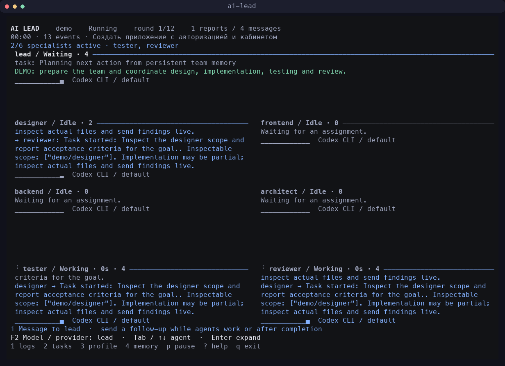
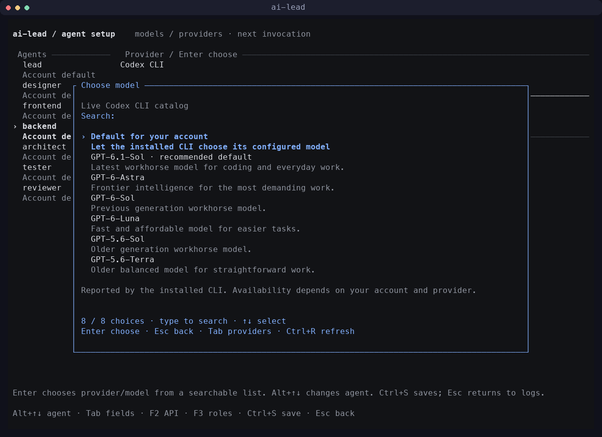
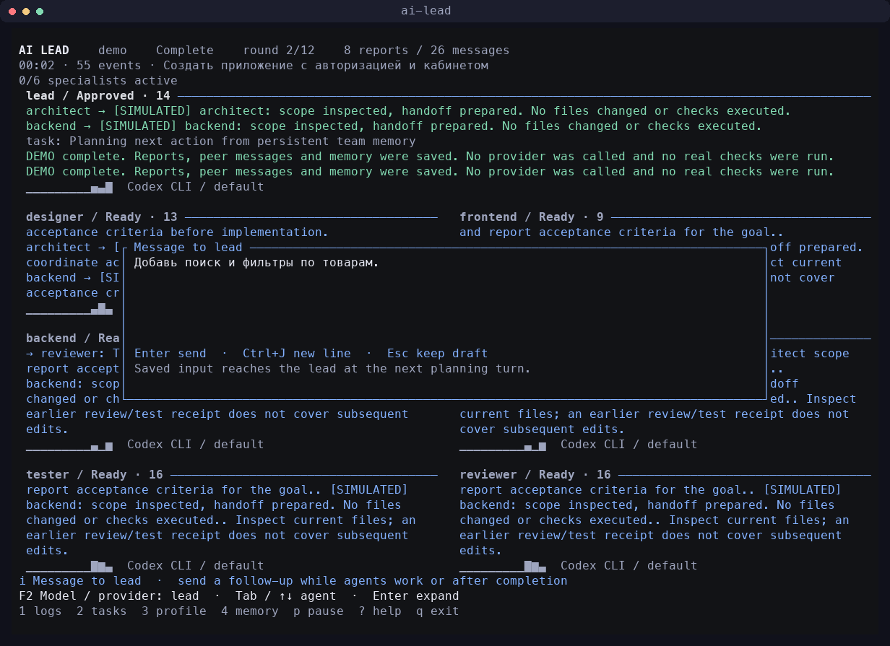

# AI-lead

**A team of AI agents, coordinated by one lead — right in your terminal.**

AI-lead is a Rust CLI with a full-screen terminal interface. Open it in your project directory, connect Codex, Claude Code, or an API provider, choose your models, and describe the task. The lead assigns work to specialists, coordinates their communication, and collects results. You can watch every agent's logs on one screen.

Each agent can have its own model, provider, reasoning level, base prompt, and skills. Independent assignments run in parallel. Shared memory, individual agent memory maps, and checkpoints stay in the project between sessions.



This screenshot shows a demo session. Demo does not call models to execute tasks or write project code. Opening the separate model catalog may retrieve metadata from a CLI or API.

[Terminal demo animation](docs/screenshots/live-team.gif) · [Model picker](docs/screenshots/desktop-models.png) · [Provider picker](docs/screenshots/desktop-providers.png) · [Message the lead](docs/screenshots/desktop-message.png)

## Contents

- [Features](#features)
- [Requirements](#requirements)
- [Installation](#installation)
- [First run](#first-run)
- [Choosing models and providers](#models)
- [Agent roles](#roles)
- [How a task runs](#workflow)
- [Terminal controls](#interface)
- [Follow-up messages](#messages)
- [Custom prompts and skills](#customization)
- [Memory and resuming work](#memory)
- [Permissions and Full access](#permissions)
- [CLI commands](#commands)
- [Configuration and project files](#configuration)
- [Troubleshooting](#troubleshooting)
- [Development and verification](#development)
- [Current limitations](#limitations)

<a id="features"></a>
## Features

- Creates a team with one lead and six specialists: architect, designer, frontend engineer, backend engineer, tester, and reviewer.
- Lets you mix Codex CLI, Claude Code, and direct API connections within the same team.
- Provides a searchable model catalog with readable names and descriptions. You do not need technical model IDs for normal setup.
- Runs independent assignments in parallel while respecting dependencies and file ownership.
- Routes messages between agents during execution; the lead receives copies of their live handoff messages.
- Accepts additional user instructions while work is running and after a task has finished.
- Lets you change models and settings in an open session. Existing calls continue; subsequent calls use the saved settings.
- Saves shared memory, individual agent maps, assignments, reports, and session logs.
- Resumes unfinished work through `resume`, preserving acknowledged results.
- Supports Demo, read-only execution, Restricted execution with writes, and Full access with explicit user consent.

AI-lead orchestrates the models and tools you connect. Results depend on the models, context, available tools, and task requirements.

<a id="requirements"></a>
## Requirements

| Requirement | Purpose |
|---|---|
| Rust **1.89+** and Cargo | Building and installing AI-lead |
| Git | Downloading the source |
| A terminal of at least **60 × 20** | Full-screen interface; **120 × 40** is more comfortable |
| Codex CLI and/or Claude Code | Connections through an installed coding agent |
| An API key for your chosen service | Direct API connections |
| Python **3.11+** | Development and terminal tests only |

Primary local verification has been performed on macOS. CI is configured for Linux and macOS. Windows has limitations around stopping descendant processes; the repository's terminal tests require POSIX.

You do not need both Codex and Claude installed. Use one CLI, API-only connections, or a mixed team. Demo is enough to explore the interface.

<a id="installation"></a>
## Installation

### From source

```bash
git clone https://github.com/Dake69/AI-lead.git
cd AI-lead
cargo install --path . --locked
```

The installed command is **`ai-lead`**. Run it from any directory:

```bash
cd /path/to/my-project
ai-lead
```

You can also install directly from GitHub:

```bash
cargo install --git https://github.com/Dake69/AI-lead.git --branch main --locked
```

### If the command is not found

Cargo normally installs binaries into `~/.cargo/bin`. Add that directory to your current terminal's `PATH`:

```bash
export PATH="$HOME/.cargo/bin:$PATH"
ai-lead --version
```

To make this permanent, add the export to your shell configuration, such as `~/.zshrc` or `~/.bashrc`, and open a new terminal.

### Running without installation

From the source directory:

```bash
cargo run
```

To open another project:

```bash
cargo run -- --project /path/to/my-project
```

### Updating

If you installed from a local clone:

```bash
cd /path/to/AI-lead
git pull --ff-only
cargo install --path . --locked --force
```

Alternatively, repeat the GitHub installation with `--force`:

```bash
cargo install --git https://github.com/Dake69/AI-lead.git --branch main --locked --force
```

Restart AI-lead afterward. An already running process keeps using the previous binary.

<a id="first-run"></a>
## First run

### 1. Open the directory where the agents should work

```bash
cd /path/to/my-project
ai-lead
```

Or specify the directory explicitly:

```bash
ai-lead --project /path/to/my-project
```

**The selected directory is the project.** AI-lead does not replace it with its own source directory or the nearest parent Git repository.

### 2. Configure a team for that directory

On the first launch, the interface shows the project path and offers to configure it:

- **Enter** creates `.ai-lead/` and opens team settings.
- **Esc** exits without creating files.

Choose providers, models, prompts, and skills. **Ctrl+S** saves the team and opens the task input.

If you close the initial setup before saving, the application offers to finish it on the next launch. Settings are independent between project directories.

### 3. Choose an execution mode

On the launch screen, **F2** cycles through execution modes:

| Mode | Behavior |
|---|---|
| **Demo** | Simulated assignments, reports, and messages; no inference or project code changes |
| **Live / read only** | Real models inspect the project and produce findings without permission to edit files |
| **Live / Full access** | Real execution with broad permissions after a separate confirmation |
| **Live / edit files** | Specialists can write files under the Restricted policy |

New projects default to Full access. Before its first use, the application explains the permissions and asks you to type **`ALLOW`**. Agents do not start before consent is given.

Choose **Demo** to explore the interface first.

### 4. Describe the result you want

For example:

> Build an electronics store with a catalog, search, filters, product pages, registration, sign-in, and a shopping cart. Choose the stack. Use a responsive interface and SQLite, and provide startup instructions. Do not publish the application.

You can specify a stack, existing constraints, design requirements, acceptance criteria, and areas that must remain unchanged. A clear expected result reduces the number of ambiguous decisions the team needs to make.

Press **Enter** to open the logs dashboard. The lead receives the task and starts coordinating work.

### Quick command-line demo

In a directory that has not been configured yet, run `init` first:

```bash
ai-lead init
ai-lead run --demo "Build an application with sign-in and a user dashboard"
```

`init` creates settings in the current project. Running it again does not overwrite an existing configuration.

<a id="models"></a>
## Choosing models and providers

**You do not need to enter provider or model IDs manually.** The normal interface lets you choose readable names from lists and saves the technical values automatically.

### During a session

1. Select an agent with **Tab** or **↑↓**.
2. Press **F2** to open its model catalog.
3. Type a name or part of a description to search.
4. Select an option with the arrow keys and press **Enter**.
5. Press **Ctrl+S** to save your choice.

Inside the model catalog, **Tab** opens the provider list. Choose a service by name, then choose a model from its catalog. **Ctrl+R** refreshes the catalog. **Esc** closes the list without applying a new choice.

Selecting a model returns you to the editor. **Alt+↑↓** switches agents, **Tab** switches fields, and **Enter** on Provider or Model reopens its list. **Esc** returns to the logs.

**Saved changes apply to subsequent calls**, even while the editor remains open. An in-flight request is not restarted and keeps using its original model.



### Before starting work

Press **F3** on the launch screen. In the editor, use **Tab** to reach Provider or Model, then press **Enter**.

You can also open settings directly:

```bash
ai-lead configure
```

### Available connections

| Connection | How it works | What to connect |
|---|---|---|
| **Codex CLI** | Runs the installed Codex CLI | Install the CLI and sign in |
| **Claude Code** | Runs the installed Claude CLI | Install the CLI and sign in |
| **OpenAI API** | Direct API | `OPENAI_API_KEY` |
| **Anthropic API** | Direct API | `ANTHROPIC_API_KEY` |
| **Gemini** | Gemini's OpenAI-compatible interface | `GEMINI_API_KEY` |
| **OpenRouter** | One API for multiple model providers | `OPENROUTER_API_KEY` for inference |
| **DeepSeek** | Direct API | `DEEPSEEK_API_KEY` |
| **Groq** | Direct API | `GROQ_API_KEY` |
| **xAI** | Direct API | `XAI_API_KEY` |
| **Mistral** | Direct API | `MISTRAL_API_KEY` |
| **Custom API** | A compatible local or custom server | Server address and its authentication method |

Built-in API presets provide default addresses and key variable names automatically. CLI authentication and API keys are separate connection methods: being signed into Codex or Claude does not configure another service's direct API.

Example API setup in your current terminal:

```bash
export OPENAI_API_KEY="your-api-key"
ai-lead
```

Set the key in the environment, not in a model field, prompt, or README. API settings store the **environment variable name**, not the secret value.

In the editor, **F2** opens connection parameters: address, key variable, and limits. Remote APIs require HTTPS; HTTP is allowed for localhost. Custom servers need a compatible protocol and tool-calling support.

### Where the catalog comes from

- **Codex:** a metadata-only `model/list` request to the installed CLI. It returns names, descriptions, and reasoning levels. If live discovery is unavailable, a clearly labeled local Codex cache may be used.
- **Claude Code:** the model list from its stream-json `initialize` control response. If discovery fails, the interface shows clearly labeled standard CLI aliases such as Opus, Sonnet, and Haiku.
- **API:** the selected connection's `/models` catalog. Provider-supplied names and descriptions are used when available. Anthropic pagination is supported. OpenRouter may provide a public catalog without a key; inference still requires one.

Model discovery does not submit the user's task for inference. Most APIs require a configured key to list models. If loading fails, the interface displays the reason and keeps the selected model unchanged.

Explicitly hidden, inactive, retired, and clearly unsuitable models are excluded. A catalog entry does not prove account entitlement, sufficient quota, or complete tool compatibility. A real invocation may still encounter a provider restriction.

### Reasoning and custom models

Press **Enter** on the Reasoning field. For Codex / OpenAI, the interface uses metadata for the selected model. If the catalog does not report available levels, Automatic is offered. Support depends on the model and provider.

For a custom server or a model not yet present in the catalog, an additional mode is available: **F4 on the Model field** enables manual ID entry. Normal setup does not require it.

Technical references: [Codex App Server](https://learn.chatgpt.com/docs/app-server), [Claude Code models and aliases](https://code.claude.com/docs/en/model-config), [Claude Agent SDK control protocol](https://github.com/anthropics/claude-agent-sdk-python/blob/main/src/claude_agent_sdk/_internal/query.py), [Anthropic model catalog](https://platform.claude.com/docs/en/api/models/list), [OpenRouter model catalog](https://openrouter.ai/docs/api/api-reference/models/list-all-models-and-their-properties).

<a id="roles"></a>
## Agent roles

The default team has seven agents: one lead and six specialists.

| Role | Main responsibility | Responsibility boundary |
|---|---|---|
| **Lead** | Task decomposition, delegation, communication, final decisions, and the final project launch | Does not write code, tests, or configuration on behalf of specialists |
| **Architect** | Choosing an unspecified stack, monolith versus services, modules, directories, and contracts | Does not take over feature implementation or tests |
| **Designer** | Visual system, UX, tokens, styles, and agreed visual primitives | Works with frontend in separate owned files; does not implement server logic or tests |
| **Frontend** | Client code, interfaces, and web/mobile/desktop/terminal applications | Does not write backend code or tests |
| **Backend** | Server and domain code, APIs, persistence, and migrations | Does not write frontend code or tests |
| **Tester** | Test authoring, fixtures, test tooling, test execution, builds, and interface verification | Reports production defects to their owners instead of patching production code |
| **Reviewer** | Independent logic review across affected areas while code is being written | Sends findings to authors and the lead; does not modify files or replace the tester |

The tester starts writing contract-based checks **alongside implementation**. The reviewer starts inspecting available code and contracts **during development**, then reviews subsequent changes and fixes. An early passing check does not approve later code.

The designer's base prompt covers blocks, sections, cards, responsiveness, interface states, accessibility, purposeful library use, two or three font families including a brand face, and two or three primary font sizes. Terminal interfaces account for the terminal's own font limitations.

The architect focuses on readable modules and directories, explicit boundaries, suitable patterns, and SOLID. Language conventions matter: Rust projects are not forced into artificial class hierarchies or inheritance.

In older configurations, the architect may still be named `devops` to preserve continuity with its existing memory.

Role boundaries are included in a separate runtime instruction. The scheduler also rejects explicit test paths assigned to other specialists and nonempty file ownership assigned to the reviewer. These are cooperative rules and assignment checks; Full access does not make them an OS-level restriction on every shell action.

<a id="workflow"></a>
## How a task runs

1. **The lead receives the goal.** It reads the current context, delegates missing technical decisions to the architect, and coordinates a shared brief.
2. **The team gets contracts and ownership.** Agents receive API interfaces, module boundaries, a shared UI objective, acceptance criteria, and their assigned files.
3. **Independent work starts in parallel.** Backend, frontend, designer, tester, and reviewer join the same plan when appropriate. Actual prerequisites are tracked separately.
4. **Specialists share intermediate results.** Authors announce inspectable changes; the reviewer sends findings, and the tester sends reproducible failures and verification results.
5. **The lead routes fixes to the right owners.** After changes, the tester reruns checks and the reviewer inspects the current implementation.
6. **The team performs final acceptance.** The lead compares the result with the criteria and attempts to launch the project using the supplied instructions. It reports the actual startup outcome and the user's available next steps.

### Parallelism and file ownership

New projects allow **6 specialists at once** by default. Existing projects retain their configured limit. Assignments with independent paths can run concurrently; overlapping writes are serialized.

For example:

| Specialist | Example independent scope |
|---|---|
| Backend | `server/` |
| Frontend | `web/pages/` |
| Designer | `web/design/` |
| Tester | `tests/` |
| Reviewer | Read-only inspection, without file ownership |

This is an example split, not a required project structure. Languages with tests colocated next to production code need exact file ownership or separate write phases. Shared manifests, lockfiles, and entry points should have one author during a change.

The lead declares dependencies through `depends_on` and ownership through `files`. An empty `files: []` means read-only; `null` or an omitted field in a legacy assignment reserves the entire project and restricts concurrency. Invalid plans are rejected before specialists start and returned to the lead for repair.

With a concurrency limit of at least 3, ready tester/reviewer assignments receive early slots. Small pools require bounded passes that do not occupy the whole queue while waiting for work that has not started.

### Completion states

| Outcome | Meaning |
|---|---|
| **Complete** | The lead declares the result complete based on the available evidence |
| **Delivered / checks pending** | Implementation is delivered, but specific checks or startup are limited by the environment |
| **Blocked / Failed** | Work remains unfinished, a defect is confirmed, or execution failed |

`listen EPERM` or an unavailable browser does not automatically prove either a defect or a successful check. Unexecuted checks must be listed with their causes and next steps. `finish_with_limits` represents this outcome; it must not hide missing features, confirmed defects, or unresolved specialist failures.

<a id="interface"></a>
## Terminal controls

**Shortcuts depend on the current screen.** In particular, F2 changes the mode on the launch screen but opens models on the dashboard.

On a Mac, function keys may require **Fn**, for example **Fn+F2**.

### Launch screen

| Key | Action |
|---|---|
| Enter | Start the entered task |
| F2 | Switch between Demo, read-only, and writable execution |
| F3 | Open team settings |
| F4 | Resume the latest unfinished task in the selected mode |
| F5 | Switch between Full access and Restricted |
| Ctrl+U | Clear the task description |
| Esc | Exit |

### Logs dashboard

| Key | Action |
|---|---|
| Tab, Shift+Tab, ↑↓ | Select an agent |
| Enter or a | Switch between the grid and an expanded agent log |
| i or n | Write a message to the lead |
| F2 or F3 | Open the selected agent's model catalog |
| 1 / 2 / 3 / 4 | Logs / tasks / profile / memory |
| PgUp / PgDn | Scroll the log |
| Home / End | Return to current events |
| p | Pause or resume log display |
| m | Toggle animation |
| ? or F1 | Help |
| q, Esc, Ctrl+C | Stop execution or exit after completion |

**`p` pauses the display only. Agents keep working.** Opening settings also does not stop background assignments.

The grid maintains a separate buffer for each agent. Active agents show an indicator, task elapsed time, and event count. Animation reflects interface activity and waiting; it is not proof that a model has already completed useful work.

### Catalog and editor

| Key | Action |
|---|---|
| Typing in a catalog | Search names and descriptions |
| ↑↓, PgUp / PgDn | Navigate the list |
| Enter | Choose an option |
| Tab in the model catalog | Open providers |
| Ctrl+R in the model catalog | Refresh the list |
| Esc in a catalog | Return without a new choice |
| Alt+↑↓ in the editor | Switch agents |
| Tab / Shift+Tab in the editor | Switch fields |
| F2 in the editor | API connection settings |
| F3 in the live-session editor | Switch between models and full role settings |
| Ctrl+S | Save the team |
| Esc in the editor | Return without saving subsequent unsaved edits |

<a id="messages"></a>
## Follow-up messages

Press **i** on the dashboard and describe what to add or change:

> Add catalog search and a price filter. Keep the existing registration flow unchanged.

- **Enter** sends the message.
- **Ctrl+J** inserts a new line.
- **Esc** closes the composer while keeping the draft in the open interface.
- Multiline paste is supported.
- Messages are limited to **16 KiB** each. If saving fails, the draft is retained.

While composing, ordinary letters such as `q`, `p`, and `m` are text rather than dashboard commands.



### When the lead reads the message

The message is saved in the project and reaches the lead at the next planning step. Assignments already running are not automatically cancelled.

If input arrives while the lead is generating an answer, the stale plan must not dispatch work or close the workflow. The lead receives the new input and plans again.

The dashboard stays open after completion. Send another prompt to continue within **the same workflow**, including its history and memory. New input receives an additional bounded planning budget.

Sent messages survive restarts. An unsent draft exists only in the current interface.

<a id="customization"></a>
## Custom prompts and skills

Before launch, open settings with **F3** or `ai-lead configure`. During a session, **F2** opens the model editor, and **F3 inside that editor** opens prompts and skills.

### An agent's base prompt

Each agent has a full multiline prompt. You can customize it, for example:

> Use the project's existing components. All user-facing text must be in English. Do not add dependencies without notifying the lead. Do not change API contracts without coordination.

In a text field:

- Enter inserts a new line;
- Ctrl+U clears the field;
- multiline paste is supported;
- Ctrl+S saves team settings.

User-authored prompt versions are stored separately in `custom-contexts/`. Updating known default templates should not overwrite customized user text.

Prompts and skills refine a role's work. They do not transfer test authoring to frontend or production fixes to the reviewer.

### Your own skills

A skill is an instruction file. Attach an ordinary Markdown file or a directory containing `SKILL.md`.

Example structure:

```text
.ai-lead/
  skills/
    frontend.md
    my-ui-rules/
      SKILL.md
```

Example `SKILL.md`:

```markdown
# UI rules

- Use the project's existing design tokens.
- Coordinate visual primitives with the designer.
- Give the tester responsive-layout criteria and form states.
- Send inspectable component paths to the reviewer after meaningful changes.
```

In **Skills**, enter one path per line:

```text
skills/frontend.md
skills/my-ui-rules
/absolute/path/to/another/SKILL.md
```

Relative paths are resolved from the directory containing `team.toml`, usually `.ai-lead/`. `~/...` is supported. For a directory, its `SKILL.md` is selected automatically.

The application adds a managed list of attached skills to the prompt, instructing the agent to read them, apply them to relevant work, and explain any inability to use them. Removed skills disappear from the list; the block should not be duplicated.

The main skill files are supplied to the agent. Additional resources referenced by a skill must be accessible through its tools. Skill dependencies are not installed automatically.

<a id="memory"></a>
## Memory and resuming work

AI-lead stores the following in the project:

- shared notes and agreed decisions;
- an individual map for each agent: facts, previous work, next steps, and blockers;
- assignments and their states;
- lead decisions, reports, messages, and delivery offsets;
- checkpoints for continuing after an interruption.

Before invocation, an agent receives its own map, shared memory, and concise information about teammates. This is persisted textual context, not a promise of unlimited model memory.

### Resume the latest task

```bash
ai-lead resume
```

For Demo:

```bash
ai-lead resume --demo
```

You can specify a workflow ID:

```bash
ai-lead resume WORKFLOW_ID
```

On the launch screen, **F4** performs the same action for the selected mode. Live and Demo memory are separate.

Acknowledged completed assignments should not repeat merely because parallel agents finished in a different order. An interrupted assignment may already have partially changed files: the agent must inspect the actual state before repeating it. Recovery does not resume an arbitrary shell command at its exact interrupted instruction.

New sent input can make continuation available even for a previously completed workflow. A new task receives the project's accumulated memory, but does not automatically repeat every old unfinished assignment.

### Inspect memory

```bash
ai-lead memory
ai-lead memory backend
ai-lead memory --demo
```

Do not edit runtime state while the application is working. Send a message to the lead to change direction.

<a id="permissions"></a>
## Permissions and Full access

### Full access

New projects default to the Full access policy. Real execution requires explicit user consent for the selected directory.

In this mode, **all agents, including the lead**, receive available shell, file, and network capabilities under the current OS user. Depending on their tools, they can operate outside the project directory. This does not grant root/admin privileges or bypass OS and provider restrictions.

Consent is stored locally for a specific project path. A TOML setting alone does not replace confirmation.

Inspect the mode:

```bash
ai-lead permissions
```

Switch to Restricted and revoke consent:

```bash
ai-lead permissions restricted
```

Enable Full access with confirmation:

```bash
ai-lead permissions full-access
```

An explicit flag is available for your own preauthorized noninteractive workflow:

```bash
ai-lead permissions full-access --yes
```

Policy changes apply to subsequent runs. Stop the active session before switching modes. The launch screen also provides **F5**.

### Restricted and read-only execution

```bash
# Explicitly keep the team read-only:
ai-lead run --read-only "Inspect the project and propose a plan"

# Allow specialists to write under the Restricted policy:
ai-lead permissions restricted
ai-lead run --write "Implement the agreed change"
```

Under Restricted, the lead is read-only. Direct API agents do not receive the shell tool; their file tools are confined to the project and block paths such as `.git`, `.ai-lead`, `.env`, and symlinks. CLI capabilities also depend on the installed agent's own restrictions and configuration.

### Keys, memory, and Git

AI-lead does not automatically write API key values into model fields or configuration. However, commands inherit the environment in Full access, and their output may appear in logs. Do not ask agents to print secrets.

Logs and memory contain task descriptions, context, and agent responses. Check which files are staged before publishing. The generated `.ai-lead/.gitignore` excludes runtime memory, sessions, and consent. Publish configuration and custom skills only after reviewing their contents separately.

In AI-lead's own repository, the local `.ai-lead/` directory is excluded entirely.

<a id="commands"></a>
## CLI commands

| Command | Purpose |
|---|---|
| `ai-lead` | Open the current project's interactive interface |
| `ai-lead --project PATH` | Open an explicitly selected project |
| `ai-lead init` | Create configuration and team templates |
| `ai-lead configure` | Open the agent editor |
| `ai-lead run "Task"` | Run a live task using the project's policy |
| `ai-lead run --demo "Task"` | Run a demo session |
| `ai-lead run --read-only "Task"` | Explicitly prohibit file changes |
| `ai-lead run --write "Task"` | Allow writes according to project policy |
| `ai-lead run --no-tui "Task"` | Use a text log instead of the full-screen dashboard |
| `ai-lead resume` | Resume an unfinished workflow |
| `ai-lead memory [AGENT]` | Inspect persisted memory |
| `ai-lead doctor` | Validate configuration and connection prerequisites |
| `ai-lead providers` | Print connection presets |
| `ai-lead models AGENT` | Print the technical model list for an agent's API connection |
| `ai-lead permissions` | Inspect the access policy |
| `ai-lead upgrade-prompts` | Update recognized, unchanged default templates |
| `ai-lead replay PATH` | Read a saved `events.jsonl` without executing agents |
| `ai-lead --help` | Full command reference |

Redirected output uses text mode. Noninteractive live Full access requires previously saved explicit consent.

`doctor` checks configuration, contexts, skills, CLI executables, and required API environment variables. It does not prove access to every model or run the full application workflow.

The `models` command is intended for API diagnostics. In the normal interface, Codex, Claude, and API models are selected through the catalog without copying IDs.

`init --provider claude` creates a Claude Code team. API initialization through CLI arguments requires technical parameters, including a model. If you do not want to enter them manually, use the normal interactive launch and editor instead.

<a id="configuration"></a>
## Configuration and project files

The main configuration is **`.ai-lead/team.toml`**. The interface editor is sufficient for normal use.

### General settings

| Setting | Default | Meaning |
|---|---|---|
| `max_parallel_agents` | `6` | Maximum concurrent specialists, from 1 to 16 |
| `max_rounds` | `12` | Planning budget; new user input extends it by a bounded number of rounds |
| `timeout_seconds` | `900` | Total timeout for an individual agent invocation, in seconds |
| `log_buffer_events` | `2000` | Per-agent event buffer, from 100 to 20000 |
| `permissions` | `"full-access"` | Project policy; execution still requires consent |
| `setup_pending` | Depends on the launch method | Whether initial setup must be completed |

These are fields in the existing file, not a complete TOML configuration to replace it with. The application creates all default roles and paths.

### Agent settings

Each agent has a connection, model, reasoning level, context path, and skill list. API connections also expose a base URL, key environment variable name, output token limit, and HTTP-turn limit. CLI connections support `extra_args`.

Provider identifiers and models are written to TOML automatically after selection in the interface. Context and skill paths are relative to the configuration directory; absolute paths are also supported.

You can define custom roles through configuration and contexts. Automatic boundaries for built-in roles and some routing behavior depend on their standard names. Keep built-in names unless you need to change them and understand the effect on those rules.

### Local file structure

```text
my-project/
  .ai-lead/
    team.toml                 team settings
    contexts/                 default role contexts
    custom-contexts/          saved custom prompts
    skills/                   role skills
    permissions.json          local Full access consent
    run.lock                  active project session lock
    memory/
      state.json              workflows and checkpoints
      agents/                 individual agent maps
    demo-memory/              separate Demo memory
    runs/
      SESSION_ID/
        session.json          initial run parameters
        status.json           status when the interface closes
        events.jsonl          event log
        transcript.json       decisions and reports
        team/
          brief.md            shared brief for the current plan
          progress.json       assignment states for the current round
          user.jsonl          sent user messages
          inbox/              agent inboxes
          outbox/             live agent messages
        001-lead/             individual invocation artifacts
          prompt.txt          supplied context
          result.json         returned result
```

Invocation artifacts vary by provider. `session.json` records the initial configuration; later model changes are saved in `team.toml` and reflected in subsequent calls.

Only one coordinator should write a project's runtime memory at a time. If another AI-lead session holds the project lock, a new session must not bypass it.

<a id="troubleshooting"></a>
## Troubleshooting

### I cannot find where to send the next prompt

Press **i** on the logs dashboard. You can send a message during execution or after completion. If the model shortcut or composer is missing after an update, close the old process and launch the newly installed version.

### I do not know the model ID

You do not need it. Select an agent, press **F2**, search by name, and confirm with Enter. Tab inside the catalog opens providers. Ctrl+S saves your choice.

### The catalog did not load

Check the following:

1. For a CLI connection, make sure the agent is installed and signed in.
2. For an API connection, set the key environment variable **in the terminal used to launch AI-lead**.
3. For Custom API, check the address and confirm the server is running.
4. Check network access and availability of the provider's catalog endpoint.

After fixing the issue, press Ctrl+R. A Codex cache or standard Claude aliases are labeled separately; neither proves entitlement for the current account.

### Changing the model had no effect

Press Ctrl+S. Saved settings affect subsequent calls, not an already running request. For API connections, also check the key's permissions and support for the chosen model.

### F2 changes the mode instead of opening models

You are on the launch screen. F2 selects the execution mode there, and F3 opens team settings. On the session dashboard, F2 opens models. On a Mac, try Fn+F2.

### Full access still cannot start the server: listen EPERM

Full access does not override system restrictions. The agent should identify the unexecuted check and its cause. If implementation is delivered but the environment prevents server or browser verification, the result may be marked as checks pending. That does not mean HTTP behavior, cookies, or responsiveness have been verified.

### Browser verification is unavailable

AI-lead does not install a browser bridge automatically. The tester uses tools available through its CLI or authorized browser-test tooling. If those tools are unavailable, visual verification must remain explicitly unperformed.

### The project did not stay running at the end

Tool subprocesses are cleaned up after execution, cancellation, and timeouts. An ordinary background `&` does not guarantee that a server survives the agent invocation. The lead must report the actual startup outcome. A persistent process needs a suitable mechanism provided by the environment, or a separate user launch following the project's instructions.

### Why is the tester or reviewer waiting?

Check the parallel limit, dependencies, and overlapping paths. If backend owns all of `src/` while the tester is assigned files inside `src/`, their writes conflict. Use narrower ownership, separate test paths, or sequential phases.

### Authentication, quota, or timeout errors

Provider errors are not treated as successful execution. Fix the connection, model access, or limits, then use `resume`. Retrying does not undo external actions already performed: inspect partial changes and migrations first.

### How do I stop work?

Press q or Ctrl+C on the logs dashboard. Changes already made are preserved. Normal cancellation reports the saved session and should not appear as `Error: Run cancelled`.

A forced `kill -9` of only the AI-lead process may leave external processes behind. Inspect them before resuming.

<a id="development"></a>
## Development and verification

```bash
cargo fmt --check
cargo build --locked
cargo test --locked
cargo clippy --locked --all-targets -- -D warnings
python3 tests/terminal_flow.py
python3 tests/session_controls.py
```

The Python scenarios require POSIX and Python 3.11+. They use a real PTY and local provider doubles. Automated tests do not require user API keys or contact paid inference endpoints.

Coverage includes configuration and persistence, model catalogs, Codex/Claude CLI handshakes, API protocols, tools, permissions, concurrency, dependencies, live messaging, roles, recovery, process cancellation, terminal rendering, and interactive input flows.

GitHub Actions is configured to run checks on Linux and macOS.

### Source layout

| File or directory | Responsibility |
|---|---|
| `src/main.rs` | CLI commands and the session interface loop |
| `src/ui.rs` | Logs dashboard, navigation, and message composer |
| `src/setup.rs` | Team, prompt, and connection editor |
| `src/picker.rs` | Searchable provider, model, and reasoning lists |
| `src/catalog.rs` | CLI model discovery and metadata handling |
| `src/engine.rs` | Lead decision loop and workflow completion |
| `src/scheduler.rs` | Concurrent assignments, dependencies, and checkpoints |
| `src/provider.rs` | Codex CLI and Claude Code invocation |
| `src/api.rs`, `src/api_tools.rs`, `src/shell.rs` | Direct APIs and their tools |
| `src/control.rs`, `src/team.rs` | User input and team communication |
| `src/memory.rs` | Persistent memory and recovery |
| `src/config.rs`, `src/permissions.rs` | Configuration and access consent |
| `src/prompts/` | Base prompts and recognized older templates for migration |
| `tests/` | Integration and terminal scenarios |

<a id="limitations"></a>
## Current limitations

- Agents share one working directory. Separate Git worktrees and technical per-agent file isolation are not implemented yet.
- Roles are defined through prompts and assignment validation. Full access provides broad tool capabilities; it does not guarantee OS-level enforcement of every responsibility boundary.
- New user messages are handled at the next planning step rather than immediately cancelling current assignments.
- API agents receive updates between HTTP turns. CLI agents receive inbox paths and instructions to check them; actual reading depends on model behavior.
- A catalog does not guarantee pricing, quota, access, or support for every tool. Account-specific behavior cannot be fully confirmed without real invocations.
- Browser access, external services, publishing, and persistent server startup depend on available tools and the environment. Reports must distinguish completed checks from unperformed checks.
- Unix invocation process groups are terminated during cleanup. Full descendant-process cleanup is not guaranteed on Windows yet.
- Older logs without checkpoints do not automatically become resumable sessions; use `replay` to inspect them.
- Built-in exact cost tracking, token accounting, and a shared monetary budget are not implemented yet. Live calls use the limits and billing of the selected services.
